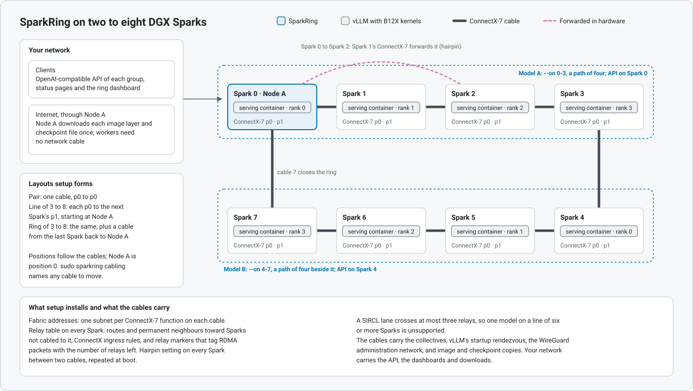

# SparkRing architecture

SparkRing runs large language models across two to eight NVIDIA DGX Sparks
that are cabled directly to each other, with no network switch. Each model is
split across a group of Sparks by tensor parallelism: every Spark holds part
of every layer, and the Sparks exchange partial results over the cables
several times per generated token. SparkRing provides the software that makes
those exchanges work without a switch, and an installer that sets up the
cables, downloads the model and starts it.

The pieces:

| Piece | What it does | Where |
|---|---|---|
| Installer (`sparkring`) | Runs on Node A, the one Spark connected to your network. `sparkring setup` configures the cables; `sparkring install` downloads an image and a checkpoint and starts a model; it also serves the ring dashboard and restarts a model that stops | [`scripts/sparkring.py`](../../scripts/sparkring.py), [`runtime/`](../../runtime/README.md) |
| Serving image | One container image, run on every Spark of a model: vLLM, B12X kernels, SIRCL, libsircl and the runtime-status plugin | [images](../operations/images.md) |
| SIRCL | SparkRing's collective layer: moves tensors between the Sparks of a group, including Sparks that share no cable | [SIRCL](sircl.md), [`spark_transport/sircl`](../../spark_transport/sircl/README.md) |
| libsircl | SIRCL's wire protocol behind NCCL's C API, so programs written for NCCL can load it instead (**research-only**) | [libsircl](libsircl.md) |
| net-sircl | An NCCL network plugin that carries NCCL's traffic over the same cables and relays (**research-only**, separate repository) | [FujitsuPolycom/net-sircl](https://github.com/FujitsuPolycom/net-sircl) |

The [README](../../README.md#profiles) lists the models that
`sparkring install` sets up; the [profile catalog](../../profiles/README.md)
lists every saved configuration.

## Topology

Each Spark has a ConnectX-7 network card with two ports, port 0 (p0) and
port 1 (p1). `sparkring setup` accepts three layouts
([cabling](../operations/install-reference.md#cabling)):

| Layout | Cabling |
|---|---|
| Pair | One cable from p0 to p0 |
| Line of three to eight Sparks | Each Spark's p0 to the next Spark's p1, starting at Node A |
| Ring of three to eight Sparks | The same, plus a cable from the last Spark back to Node A's p1 |

Node A is position 0, and positions follow the cables. Each port appears to
the operating system as two network functions, so each cable carries two
fabric subnets ([addresses](../operations/install-reference.md#addresses-on-any-layout)).

**Relays.** A Spark can only send directly to its cable neighbours. To reach
a Spark further away, its packets pass through the Sparks in between, whose
ConnectX-7 cards forward them in hardware without involving their CPU or GPU.
On a ring of eight, traffic from Spark 0 to Spark 3 crosses Sparks 1 and 2:
two relays. `sparkring setup` installs one
[relay table](../operations/install-reference.md#the-relay-table) on every
Spark that serves every pair of Sparks: routes toward Sparks it shares no
cable with, ConnectX rules that pass a packet out of the other port, and a
marker process that tags each RDMA packet with the number of relays left.
Every Spark between two cables also needs the ConnectX
[hairpin setting](../operations/install-reference.md#the-hairpin-setting).
Boot services restore the setting and the relay table after every reboot
([boot and reboot](../operations/install-reference.md#boot-and-reboot)).

A SIRCL connection crosses at most three relays. A ring of eight stays within
that limit (the farthest Spark is three relays away either way round), and so
does a line of up to five Sparks. One model on a line of six or more Sparks
is **unsupported** because its end Sparks are four or more relays apart
([models on part of the fabric](../operations/install-reference.md#models-on-part-of-the-fabric)).
The six-Spark GLM-5.3 profile `glm53-nvfp4-csf-tp6` (**research-only**)
runs on positions 0-5 of an eight-Spark ring and routes around the whole
ring, so none of its connections crosses more than three relays
([guide](../../profiles/glm53-nvfp4-csf-tp6/README.md)).

**Groups.** A fabric serves one model on all its Sparks, or several models
side by side on groups of consecutive Sparks that share no Spark
(`--on 0-3`, `--on 4-7`). Each group's first Spark serves its API.
Operations on separate groups can run at the same time
([independent slices](independent-slices.md)).

**Node A and your network.** Only Node A needs your network. It serves the
API of a group that starts at Node A, the ring dashboard (port 8090), and
downloads each image and checkpoint once for the other Sparks. Everything
between Sparks runs over the cables: collectives, vLLM's startup
rendezvous, image and checkpoint copies, and an administration network for
SSH (WireGuard over the cables' IPv6 link-local addresses, falling back to
other fabric functions and then the LAN).

## Serving container

Every Spark of a model runs one container of the same image and holds one
tensor-parallel rank. vLLM schedules requests; its kernels come from
[B12X](https://github.com/local-inference-lab/b12x), Local Inference Lab's
kernel library for GB10 (SM121) GPUs. Each profile's
`profiles/<id>/config.json` selects the model, the vLLM arguments and the
transport limits ([install reference](../operations/install-reference.md)).

The installer's default image is release 2026.10.5,
`dev-20261016-sparkcache-4a17f1f5198e-status038`. It carries SIRCL 0.3.2,
libsircl 0.6.0, three GLM-5.3 vLLM plugins, runtime-status 0.3.8 and
SparkCache for three models, and
its [image lock](../../runtime/releases/dev-20261016-sparkcache-4a17f1f5198e-status038/installer-image.json)
admits 20 profiles. Release 2026.10.4 is its rollback
(`--image 2026.10.4`). [Images](../operations/images.md#installer-image)
describes both.

## Collective path

A **collective** is an operation in which every rank of a group takes part:
an all-reduce sums each rank's partial result and gives every rank the
total; an all-gather gives every rank every rank's piece. A decode step runs
two all-reduces per layer and one all-gather of the vocabulary. Decode
messages are small, so there a collective's latency matters more than
bandwidth; prefill sends large messages.

`sparkring install` runs collectives on one of four transports
([transport and receipts](../operations/install-reference.md#transport-and-receipts)):

| Transport | When it runs | Status |
|---|---|---|
| `sircl`: SIRCL ring sessions, NCCL off | The default wherever it can run: an image whose lock lists `sircl`, such as the default image, on a fabric whose relay table `sparkring setup` installed. Any installer profile on a pair, a line of three to five Sparks, a whole ring of three to eight, or a group within it | One-shot all-reduce and all-gather **qualified** on the eight-Spark ring; serving through vLLM **research-only** ([status](../../spark_transport/sircl/STATUS.md#component-status)) |
| `prepared`: RoCEnante plus NCCL 2.32.3 | Images without SIRCL, such as release 2026.10.1's; a fabric that cannot carry `sircl`; or `--transport prepared`. Runs on a pair, a ring of four and that ring's halves only | **implemented** |
| `nccl`: vLLM's PyNccl on NVIDIA NCCL | Only with `--transport nccl`, on a cabled pair or a whole ring; refused where ranks need relays | Opt-in |
| `libsircl`: vLLM's PyNccl on libsircl | Only with `--transport libsircl`, on an image whose lock lists `libsircl` | **research-only** |

**SIRCL**, the Switchless Inference RDMA Collective Layer, is described in
[SIRCL](sircl.md). vLLM plugins named `sircl` put a SIRCL session in front of
every collective of the tensor-parallel and decode-context-parallel groups.
NCCL stays off unless the operator passes `--nccl auto`. Each rank writes
receipts naming what carried each collective, and `sparkring check` reads
them. A tuning table chooses SIRCL's algorithm per message size: the
package's default, or one that `sudo sparkring fabric tune` measured on your
fabric.

The **prepared** transport, shown as `RoCEnante (b12x)`, splits collectives
by size. RoCEnante, B12X's RoCE collectives with SparkRing's adaptive peer
paths, takes all-reduces up to 2 MiB and all-gathers up to 16 MiB per shard,
which covers decode. NCCL 2.32.3 takes larger collectives, mostly prefill.

**libsircl** and **net-sircl** are two ways to use SIRCL's cabling outside
SIRCL's own sessions. libsircl replaces the NCCL library; net-sircl keeps
NVIDIA NCCL and its algorithms and replaces only NCCL's network transport,
including peers reached through relays. net-sircl is published separately
at [FujitsuPolycom/net-sircl](https://github.com/FujitsuPolycom/net-sircl)
(version 0.1.1, aarch64 builds); `sparkring install` does not use it.

## Profile composition

Catalog profiles that `sparkring install` does not set up have their own
images, launchers and guides, and each guide states its collective path.
They use one of three compositions:

- **Patched NCCL alone**, with the environments in `scripts/config/`:
  DeepSeek-V4-Flash-0731 and the Qwen3.8-27B EXL3 K5/K6 pair and ring.
- **Four-rank native SIRCL sessions with patched NCCL**: SIRCL carries the
  tensor-parallel all-reduce and the vocabulary collectives on exactly four
  Sparks of a four-Spark ring; NCCL carries the rest. The GLM-5.3-Flash
  four-Spark profiles of shared runtime 2026.09.3
  ([`glm53-flash-spark-tp4-dcp1-sparkcache`](../../profiles/glm53-flash-spark-tp4-dcp1-sparkcache/README.md)
  and its variants, [`runtime/common/glm_tp4.py`](../../runtime/common/glm_tp4.py))
  and the retired GLM-5.2 EXL3 3.5-bpw profile use it
  ([SIRCL](sircl.md#profile-use)).
- **The four-Spark mesh composition** of four-rank SIRCL, an adapted
  RoCEnante all-reduce and patched NCCL, with a per-deployment mesh service.
  Only the retired managed-mesh profile uses it
  ([composition](sircl.md#composition-with-hardware-forwarded-mesh)).

On rings of four, these profiles need routes to the non-adjacent fabric
subnets, `net.ipv4.ip_forward=1` and an unrestricted `DOCKER-USER` forward
rule on every Spark. [Prerequisites](../operations/prerequisites.md) lists
them and [`scripts/ring_doctor.py`](../../scripts/ring_doctor.py) checks them.

Guides:
[DeepSeek-V4-Flash-0731](../operations/deepseek-0731.md),
[Qwen3.8-27B EXL3 K5/K6 pair](../../profiles/qwen38-27b-exl3-k5k6-pair/README.md),
[Qwen3.8-27B EXL3 K5/K6 ring](../../profiles/qwen38-27b-exl3-k5k6/README.md),
[GLM-5.3-Flash four Sparks](../../profiles/glm53-flash-spark-tp4-dcp1-sparkcache/README.md) and
[GLM-5.2 EXL3 3.5-bpw (retired)](../../profiles/glm52-exl3-r7-3.5bpw/README.md).
