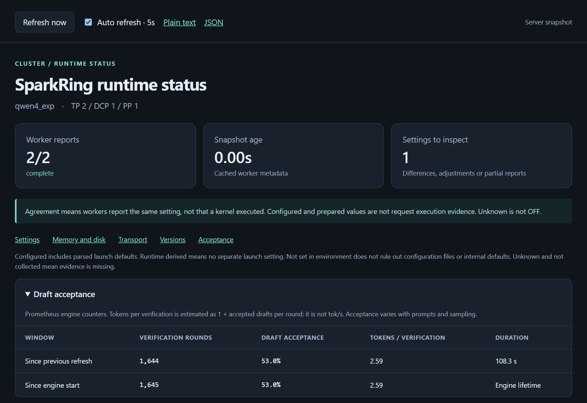
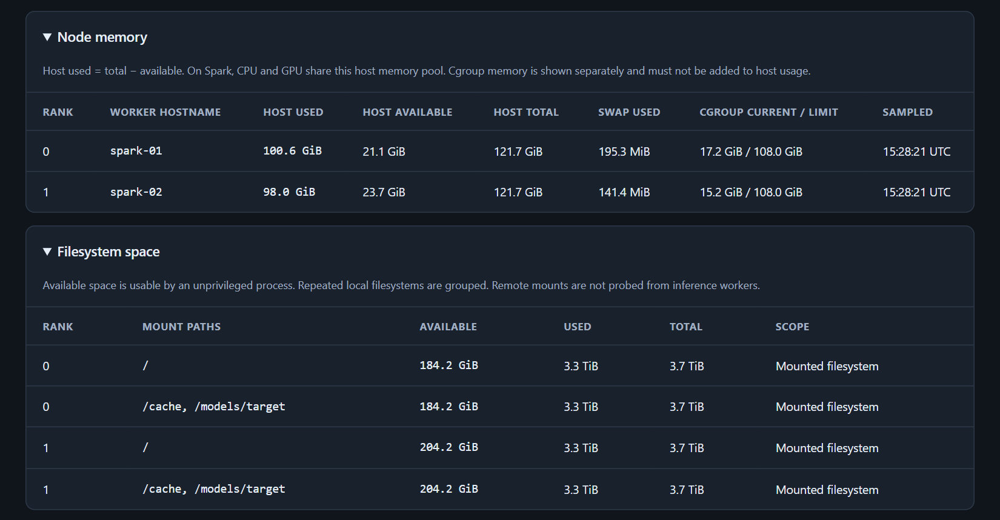
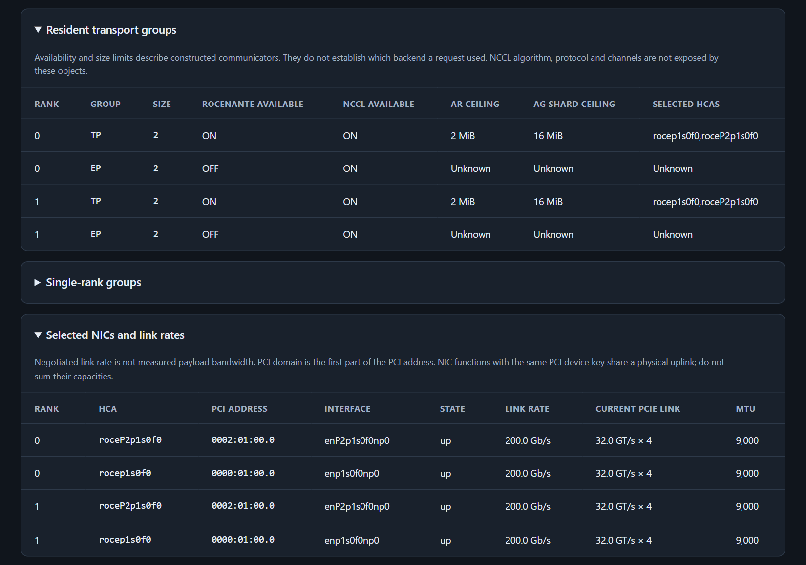
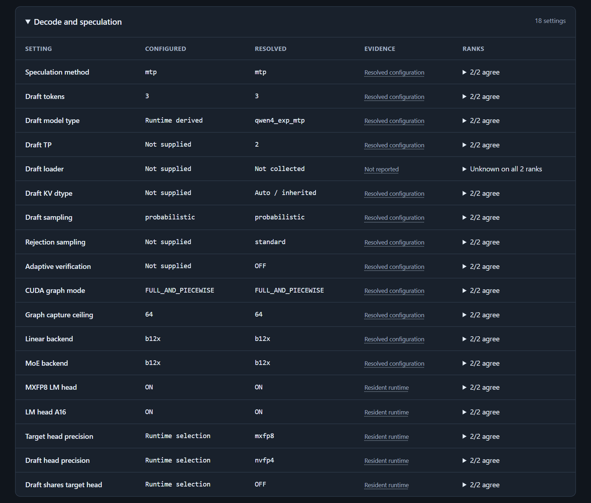

# Status dashboard

SparkRing has two read-only status pages:

- a **model status page** for each model, served by that model's API;
- a **ring dashboard** on Node A that shows every Spark and every model of the
  ring on one page, also as a terminal view.

Neither page sends an inference request, runs a benchmark or changes a
setting.

## Model status page

```text
http://API_HOST:PORT/v1/sparkring/status/view
```

- `API_HOST` is the deployment's first Spark, where its API serves: Node A
  for a model on positions starting at 0, Spark 2 for a model installed with
  `--on 2,3` ([several models on one ring](install-reference.md#two-models-on-one-ring)).
  A deployment installed with `--api-bind` serves only at that address.
- `PORT` is the profile's API port, 8000, 8015 or 8020
  ([ports by profile](install-reference.md#security-and-host-exposure)), or
  the port that `--api-port` sets ([API endpoint](install-reference.md#api-endpoint)).

The card that `sparkring install` prints after `Model ready:` gives the exact
address as `Model status:`. The page refreshes every 5 seconds while it is
visible; a checkbox pauses it and a button refreshes at once.



## What it shows

| Section | What you see |
|---|---|
| Summary | Sparks reporting, data age and settings to check |
| Draft acceptance | MTP draft tokens accepted since the last refresh and since start, overall and per draft position |
| Memory and disk | Used and available memory on each Spark (CPU and GPU share it) and free disk space |
| Versions | NVIDIA driver, CUDA, NCCL, library and package versions on each Spark |
| Transport | Whether the RoCE all-reduce adapter (B12X) and NCCL are available, the NICs in use, link rates and RDMA traffic. On images with runtime-status 0.3.6 or later (releases 2026.10.2 and 2026.10.4) it also names the transport that carries the collectives and, on SIRCL ring sessions, each worker's SIRCL session, relays and receipt age |
| Settings | Each serving setting as configured and as the model resolved it, and whether all Sparks agree |
| Workers | Draft tokens, KV transfer and kernel setup on each worker |
| Build information | Image, packages and source commits |

Links under the summary jump to each section; `#nodes` at the end of the
address opens the page at memory and disk.

Two settings tables need a note:

- **Chat and tools** shows the reasoning parser, the tool-call parser and the
  default chat template arguments, or `Not set (the chat template decides)`.
  The last two read `API server only`, because only the API server holds
  them. A request's `chat_template_kwargs` or `reasoning_effort` overrides
  these defaults.
- **Decode and speculation** ends with `Shared-memory reader window`: how long
  vLLM's waiting processes poll after each step before they sleep. It reads
  `2 ms (sparkring install --save-cpu)` with
  [`--save-cpu`](install-reference.md#serving-settings) and
  `1 s (vLLM default)` without.







## From a terminal

```bash
curl http://API_HOST:PORT/v1/sparkring/status.txt   # the report as text
curl http://API_HOST:PORT/v1/sparkring/status       # the report as JSON
vllm-top --url http://API_HOST:PORT                 # live rates
```

[vllm-top](https://github.com/mratsim/vllm-top) shows live prefill and decode
rates, queue, KV cache use and MTP acceptance.

## Access

Like the model API, the page has no key and listens on every interface of
`API_HOST`. It shows hostnames, NIC MAC addresses and software versions, so
keep that Spark on a trusted network ([Security](install.md#security)).

## Every model on one page

Status: **Experimental** (research-only); covered by offline tests only.

```text
http://NODE_A_LAN_ADDRESS:8090/
```

- `NODE_A_LAN_ADDRESS` is the address setup recorded for Node A's LAN
  connection, or Node A's management address when there is none. Setup's
  plan prints it, and the card after `Model ready:` prints it as
  `Ring dashboard:`.
- The service listens on that address and on `127.0.0.1`, never on the fabric
  or the administration network
  ([why loopback as well](#why-loopback-as-well)).
- Installing the SparkRing package or running `sudo sparkring setup` turns it
  on. `sudo sparkring dashboard disable` turns it off across reboots, setups
  and upgrades; `sudo sparkring dashboard enable` turns it back on.
- `install`, `up`, `down` and automatic recovery update it within about a
  second, without a restart.

The page reads files on Node A and sends GET requests to the model APIs only
while someone views it. Node A's host agent forwards startup and container
observations from the other Sparks over the existing SSH path; the web service
opens no SSH session and no Docker socket.
`sudo sparkring dashboard quiet on` stops every request, for example during a
benchmark. The [command reference](commands.md#dashboard) lists what the
service reads and how often.

### Ring figure and totals

The ring figure follows the cable topology: one numbered rectangle per Spark,
with an allocation strip below it. Each managed group has its own colour
(teal, green, violet, then blue, in order of lowest position), shared by its
cables, card edge and graph lines. Groups not installed by SparkRing and other
GPU jobs have muted outlines; stopped deployments are dim. Amber diamonds mark
cable segments that a shortest route through an intermediate Spark uses,
derived from the topology rather than measured traffic. The page follows the
browser's light or dark theme and loads nothing from other sites.

Each ring shows its total output tok/s, running requests and queued requests,
in the centre of the ring or below the allocation strip when the centre has
no room. The totals add up the same snapshots as the model cards, one per
serving group, and round once to whole numbers. Starting and stopped groups
count as zero. The summary tiles at the top use the same sums across all
rings.

### Spark details

Hover a numbered Spark, focus it with Tab, or tap it to open its details card.
Escape, a second tap, or a tap outside closes it; Enter or Space pins or
closes the focused card.

The card shows the hostname, management address, ring position, serving group
and model, rank, TP/DCP size, and that Spark's startup progress or serving
state. Container state, health, the last error line of a failed Spark, NIC
link state, GPU memory and temperature appear when they have been observed;
missing values are left out. Cable peers come from the configured fabric.
**Updated** dates the startup or API observation; **Node cache** dates the
hardware, link and container facts, which can be older. Opening the card
sends no request.

### Startup progress

Before a model's API answers, the ring and its card show its startup phase:

| Phase | Shown as |
|---|---|
| Installer | Checkpoint check, Downloading checkpoint, Copying checkpoint, Loading image, Deriving checkpoint, Starting |
| Model container | Loading weights, Compiling, Tuning B12X, Capturing CUDA graphs |

Counts appear when the logs report them, such as `Loading weights 12/43`;
transfers show a whole percentage. The card shows the time since the
operation or container started, and per-Spark detail when ranks differ. An
exited container or failed health check shows **Failed** with its last error
line. An answering API shows **Serving** unless a fresh container observation
reports a failure.

Startup progress needs the host-agent package on the Sparks and covers
containers that SparkRing labelled with a deployment and rank. Log lines are
recognized from known messages only; anything else leaves the phase
unchanged. Reads are bounded and stop when no one views the page
([runtime/host/startup.py](../../runtime/host/startup.py)). Recognition is
tested against archived vLLM, B12X and installer logs, not qualified on
hardware.

### Rates and graphs

A serving card shows:

- four tiles: output tok/s, prefill tok/s, running and maximum requests, and
  KV cache in use as a percentage of tokens;
- a line with steps/s, draft acceptance and accepted draft tokens per step;
- graphs of output, prefill and KV cache use, and a chip per Spark;
- **Thinking**: the thinking mode, the default effort level and the available
  levels when a request does not choose, such as
  `Thinking: always · high (levels: low, high or max)`.

**Details** expands settings, recovery, totals, logs and container facts. A
stopped deployment shows its last model and a command to start it again.

While someone views the page, each group is sampled every 2 seconds and rates
use about 6 seconds of samples. Prefill from vLLM's `/metrics` is marked
**approximate**, because it can include cached tokens; images with the
SparkRing stat logger (runtime-status 0.3.7 or later, release 2026.10.4)
count computed prompt tokens instead. Steps/s needs vLLM's
`--enable-logging-iteration-details`, which no profile sets; without it the
value is a dash.

**Window** sets every graph to Auto, 5 min, 15 min, 1 h or 3 h; Auto fills
the width with up to 3 hours of history. **Pause** freezes the graphs while
the tiles keep updating. Click a graph, or focus it and press Enter, for a
frozen view of up to 6 hours. Precision, counter sources and cost are in
[dashboard counters](../development/dashboard-counters.md).

### Models installed outside SparkRing

The page also shows vLLM and SGLang containers that the host agents find
running. Their cards say **Not installed by SparkRing: no automatic recovery,
no install record** and show the Sparks, engine, image, served name and
parallel sizes. Containers that share a head Spark and rendezvous port form
one group; a group with missing ranks shows **incomplete: N of M Sparks
reporting**. Only rank 0's reported API port is read, with no port scan;
SGLang needs `--enable-metrics` for rates. **Thinking** reads **unknown**
unless the launch or runtime status gives explicit chat defaults. The
[observation contract](../development/dashboard-counters.md#unmanaged-model-observations)
states the bounds and freshness rules.

### Terminal view

The same status in a terminal on Node A, for example over SSH:

```bash
sparkring dashboard tui            # q quits; d expands the selected model's card
sparkring dashboard tui --once     # one frame as plain text
```

It reads only the service on Node A, at `http://127.0.0.1:8090` or at
`NODE_A_LAN_ADDRESS` when loopback does not answer, and refuses other hosts.
While open it counts as a viewer, as the page does; `--passive` does not.
Each card ends with its Sparks' rank, LAN address, memory and free disk;
free disk below 2% of the root filesystem is red. Keys and options are in
the [command reference](commands.md#dashboard).

### Why loopback as well

Programs on Node A, such as the terminal view, `curl` or a monitoring agent,
reach the service at `127.0.0.1` without knowing which LAN address setup
recorded, and keep working when that address changes. It widens nothing:
every program on Node A can already reach the LAN address, and no other host
can reach Node A's loopback.

`serve --bind ADDRESS` replaces the LAN address and keeps loopback beside it;
a loopback or wildcard address (`0.0.0.0`, `::`) is used alone. When another
program holds port 8090 on loopback, the service logs one line and serves on
the LAN address only.

## Ring display name

`sudo sparkring name "Draupnir"` on Node A labels the ring dashboard, the
terminal view and the browser tab (for example `Draupnir · ring of 8`);
`sudo sparkring name --clear` restores the cluster name. The change shows
without a restart and changes no cluster or deployment identity
([`sparkring name`](commands.md#name)).

## Managing slices

Management is off by default. On Node A, an administrator can opt in to the
privileged helper and give the unprivileged dashboard a token:

```bash
sudo systemctl enable --now sparkring-helper.socket
sudo sh -c 'umask 077; python3 -c "import secrets; print(secrets.token_urlsafe(32))" > /etc/sparkring/dashboard-manage.token'
sudo systemctl edit sparkring-dashboard.service
```

Use this service override:

```ini
[Service]
SupplementaryGroups=sparkring
LoadCredential=manage-token:/etc/sparkring/dashboard-manage.token
ExecStart=
ExecStart=/usr/bin/sparkring dashboard serve --manage --manage-token-file %d/manage-token
```

Restart the dashboard service. Give the token only to operators allowed to
change serving models, and use a trusted administration connection or an
HTTPS reverse proxy: anyone holding the token can manage the ring. The page
keeps the token in its password field, never in browser storage or a URL.
Removing the override and restarting returns to read-only mode; replace the
file and restart to rotate the token.

Each slice's buttons install or swap a model, stop it, restart it, turn
recovery on or off, or show logs. Choose a profile and, optionally, a
checkpoint, context length, KV cache or download limit, then select
**Review plan and activity**. Read the plan and warnings before selecting
**Confirm reviewed action**. A confirmation can be used once and expires
after 5 minutes; a changed deployment, fabric or package needs a new review,
and a conflict never runs.

Actions go through the helper's allow-list and are recorded in its journal.
A long install keeps the request open; follow it with the displayed
`sparkring logs --on POSITIONS --follow` command in another terminal.
**Follow logs** shows one snapshot and that command.

The [slice design](../architecture/independent-slices.md) covers lock scopes,
shared-resource warnings and qualification limits.

## Source

The model status page is SparkRing's runtime-status vLLM plugin
([integrations/vllm/runtime_status](../../integrations/vllm/runtime_status/README.md)).
The ring dashboard is `runtime/host/dashboard.py`, its page
`runtime/host/dashboard.html` and its terminal view
`runtime/host/dashboard_tui.py`.
