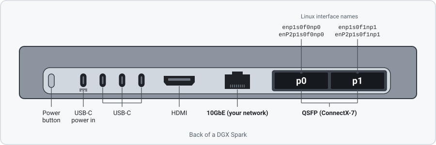
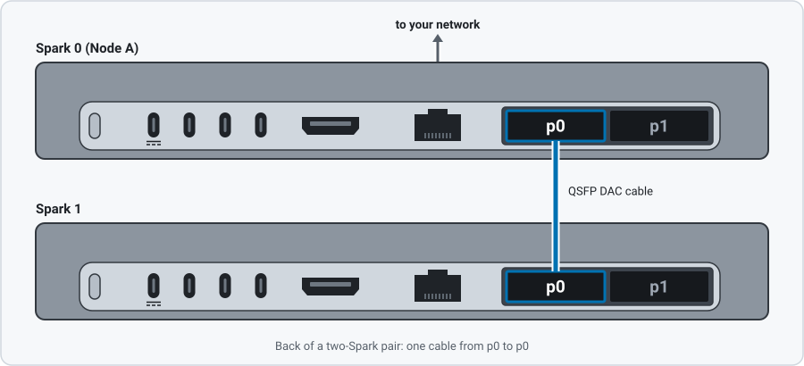
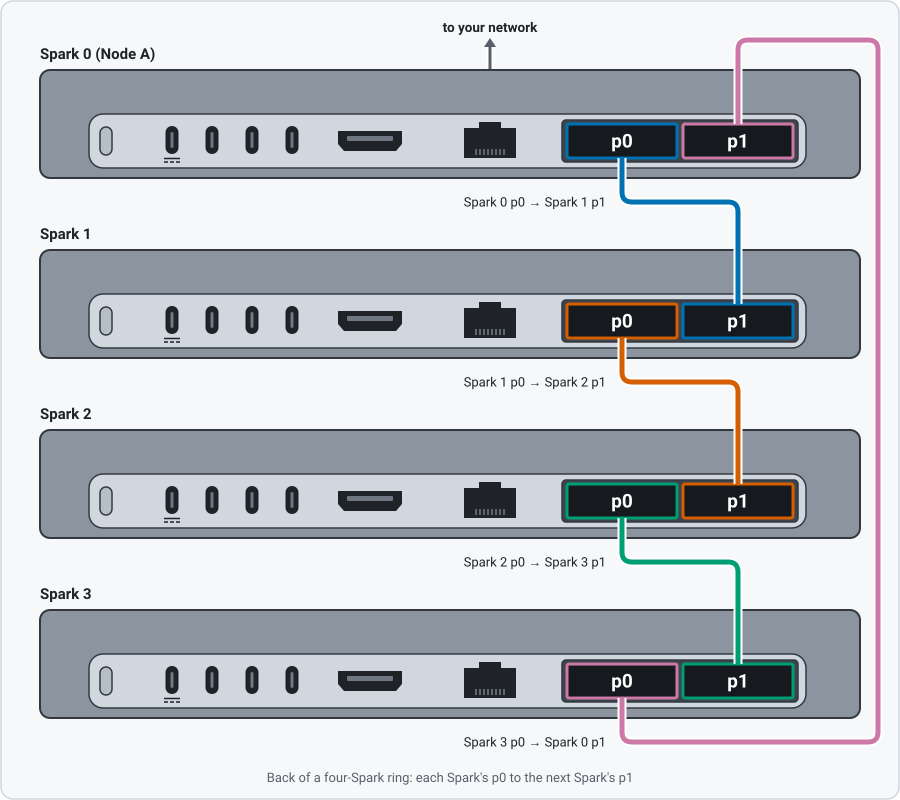

# Install SparkRing

`sparkring install` sets up two to eight cabled DGX Sparks and starts a model
on all of them, or several models on separate groups of them. Run it on
Node A, the Spark connected to your network.

[Install Builder](https://fujitsupolycom.github.io/sparkring/) ·
[All commands and flags](commands.md) · [Reference](install-reference.md)

## Requirements

- Two to eight DGX Sparks on the same DGX OS (Ubuntu 24.04 ARM64) with working
  NVIDIA drivers, Docker, NVIDIA Container Toolkit, NetworkManager and SSH.
  Setup does not install drivers or firmware.
- Root or sudo on every Spark.
- Cables: a pair connects port p0 to p0; a ring connects each Spark's p0 to
  the next Spark's p1, and a line does the same without the last cable. p0 is
  the QSFP port next to the 10GbE (RJ45) port. `sudo sparkring cabling` checks
  the cables and names any cable to move.
- Node A on your network with outbound HTTPS to `github.com`,
  `fujitsupolycom.github.io`, `ghcr.io`, `huggingface.co` and your Ubuntu
  mirror. Workers need no network cable.
- Free disk on each Spark that has neither the image nor the model: about
  163 GiB for Qwen, 233 GiB for MiMo, 236 GiB for GLM-5.3-Flash, 238 GiB for
  Swift, 505 GiB for GLM-5.3 or 547 GiB for DeepSeek, plus 14.2 GiB on Node A.
  A Spark that already holds the image needs about 47 GiB less. The plan
  checks free space before it changes anything.







Not supported: other port layouts, Docker's containerd image store
([check which one a Spark uses](install-reference.md#check-for-the-containerd-image-store)),
and one model on a line of six or more Sparks. The six-Spark GLM-5.3 profile
runs on six positions of an eight-Spark ring (research-only).

## Install

Pick a `--profile` from the [profile table](../../README.md#profiles), or
build the commands in the [Install Builder](https://fujitsupolycom.github.io/sparkring/),
then run on Node A:

```bash
curl -fsSL https://fujitsupolycom.github.io/sparkring/install.sh | bash -s -- --profile PROFILE
```

- It asks before it installs the SparkRing package, before it changes any
  Spark and before a model download larger than 1 GiB. `--yes` answers these.
- `--plan` shows what it would change and changes nothing.
- Stopping another program's GPU container needs its own answer, or
  `--stop-workloads`.
- `--checkpoint NAME` installs another checkpoint of the profile
  ([checkpoints](install-reference.md#another-checkpoint-of-a-profile)).
- `--download-limit 850Mbit` caps the Hugging Face download
  ([details](install-reference.md#limit-the-download-rate)).

A model that is already running keeps serving while the new model's image and
weights are prepared. The first start on new Sparks can take 10 to 30 minutes;
progress names what the model is doing. If the install stops early, run the
same command again; it continues where it stopped.

The install ends with `Model ready:`, the API and dashboard addresses, a sample
request and the commands to watch logs, stop, start again or uninstall.

This command installs the release the Install Builder describes. To install
`main` or another commit, use the
[pinned command](install-reference.md#get-the-package).

## Rings and several models

On a ring, the installer applies a ConnectX driver setting (hairpin) and the
fabric's [relay table](install-reference.md#the-relay-table) on every Spark and
restores both at each boot. After a reboot, `sudo sparkring fabric verify`
checks the fabric. If `sudo sparkring status` shows `needs-attention`, run
`sudo sparkring hairpin`.

`--on` puts a model on consecutive Sparks and leaves the others to other
models. On an eight-Spark ring:

```bash
sudo sparkring install --profile FOUR_SPARK_PROFILE --on 0-3
sudo sparkring install --profile FOUR_SPARK_PROFILE --on 4-7
```

Pairs (`--on 0,1` to `--on 6,7`) and groups across the cable to Node A
(`--on 6-1`) work the same way. Each group serves its API on its first Spark;
`sudo sparkring status` prints one block per group, and `--on` names the group
for `down`, `up` and `check`
([models on part of the fabric](install-reference.md#models-on-part-of-the-fabric)).

`sudo sparkring fabric tune --execute`, run while no model serves, measures
SIRCL's tuning table for your cables; install again afterwards
([measure the tuning table](install-reference.md#measure-the-tuning-table)).

## Reuse a model already on disk

The installer looks for the model on every Spark (Hugging Face caches and
local model folders, never network storage), checks each file's SHA-256 and
hard-links it. It never changes your files. Sparks without a copy get one over
the cables. If the search misses your copy, name it:

```bash
sudo sparkring install --profile PROFILE --model-path /data/models/my-model
sudo sparkring install --profile PROFILE --model-path 0=/data/a --model-path 1=/mnt/nvme/b
```

- `--ignore-local-copies` uses only SparkRing's own copies and the paths you
  name; `touch FOLDER/.sparkring-ignore` keeps the search out of a folder.
- `sudo sparkring checkpoints` lists SparkRing's checkpoint folders and the
  space each would free; `--release PATH` deletes one on every Spark after you
  confirm. It refuses the running model's folder.

## Status, logs and recovery

```bash
sudo sparkring status --refresh     # each Spark's state and the running models
sudo sparkring logs --follow        # installation progress
```

The [ring dashboard](dashboard.md) on Node A, port 8090, shows every Spark and
model. Installer logs are in `/var/log/sparkring/`.

Node A restarts a model that stops serving. `sudo sparkring recover off --on
GROUP` turns that off for one group, and `--no-auto-recover` installs a model
without it ([automatic recovery](install-reference.md#automatic-recovery)).

## Security

The model API has no key and listens on every interface of the Spark that
serves it: keep that Spark on a trusted network or firewall the port. Setup
adds a WireGuard administration network and an SSH service on port 2222 for
Node A's key, and shares Node A's Internet connection with the workers
([details](install-reference.md#security-and-host-exposure)).

## Troubleshooting

| Symptom | Fix |
|---|---|
| `Some Sparks need noninteractive SSH and sudo` | Run the printed command on each listed Spark, then repeat |
| A Spark lacks free space | Free space where the message says, then repeat |
| The plan does not use your copy | `--model-path N=PATH` |
| `The checkpoint plan differs from the plan reviewed with --plan` | Run with `--plan` again, then `--yes` |
| `in use. No ConnectX driver was restarted` | Stop what the message lists, then repeat |
| A model log shows `NVMLError_Unknown` or `Can't initialize NVML` | Run the install command again ([details](install-reference.md#install-a-model)) |
| Deleting a copy freed no space | `sudo sparkring checkpoints --release PATH` |

## Uninstall

```bash
sudo sparkring down --execute   # on Node A: stop the model
sudo apt remove sparkring       # on each Spark
```

Removal stops SparkRing's services and keeps models, caches and network
settings ([what removal keeps](install-reference.md#what-is-installed)).
